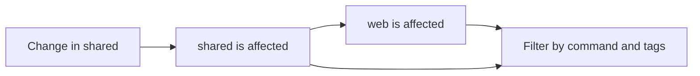

## Workspaces and projects

A **workspace** is a directory containing `isox.json`. Isox searches upward from
your current directory and uses the nearest marker. A nested workspace has its
own root.

A **project** is a directory containing `project.json`. Its name is explicit or
defaults to the directory name, and must be unique within the workspace. Its
location determines the project root.

```text
my-workspace/
├── isox.json
├── package.json
├── apps/
│   └── web/
│       ├── project.json
│       └── src/
└── packages/
    └── shared/
        ├── project.json
        └── src/
```

Project discovery uses `project.json` files. Package-manager workspace settings
continue to control dependency installation and package linking.

## Commands and executors

A **target** (also called a project command) is a named entry under a project's
`targets` object, such as `build`, `lint`, or `test`. An **executor** is the
implementation that runs it.
Commands can have any name; `build` has no special scheduling behavior.

```json
{
  "name": "shared",
  "targets": {
    "build": {
      "executor": "js:tsc",
      "options": { "tsConfig": "packages/shared/tsconfig.build.json" }
    }
  }
}
```

Run that command with `isox build shared` or `isox run shared:build`.
The `js:tsc` reference resolves to the `tsc` executor in `@isox-sh/js`, which must
be installed in the workspace. First-party references can omit `@isox-sh/`.

The built-in `core:run-command` executor ships with the CLI and runs shell
commands. Each plugin defines how it interprets options and chooses a working
directory. [Shell commands](/docs/shell-commands) default to the workspace root;
[Vitest](/docs/vitest) runs from the project root.

## Configurations

A **configuration** is a named set of option overrides on one command. Select it
with `--config=production` or use `--prod` for `production`. A command can set
`defaultConfiguration` for invocations that do not choose a configuration.

Overrides merge at the top level. Nested objects and arrays replace their base
values. Execution commands forward unknown CLI flags as executor option overrides,
which take precedence over the selected configuration. Executors may validate these
options; configure flags for the underlying tool through the executor's supported options.

See the [CLI reference](/docs/cli#named-configurations) for complete examples.

## Project dependencies

On-demand dependency analysis builds a graph from TypeScript and JavaScript imports, local package
dependencies, TypeScript path aliases, and explicit `dependencies` in
`project.json`. Type-only imports and test files also contribute to this graph.

For example, if `web` imports `shared`, a change to `shared` affects both projects:



Use explicit dependencies for relationships that cannot be inferred, such as
dynamically selected plugins. Dependencies contain Isox project names.

<Note>
  The graph propagates affected changes. It does not schedule prerequisite tasks.
  Build libraries before their consumers, and prepare required outputs in every
  CI worker. Parallel commands do not imply a dependency execution order.
</Note>

## Discovery caching

Isox stores project definitions with merged target defaults and explicitly
declared dependencies in `.isox/workspace.json`. Single-project commands reuse
those resolved targets without recalculating defaults or analyzing sources. Run
`isox reset` after project-definition, target-default, or discovery-rule changes.
Ordinary source and import edits do not change this cache.

Affected selection infers dependency relationships on demand. Executors can also
request them: the TypeScript builder analyzes its project's dependency closure
when remapping workspace aliases. These requests validate and reuse per-project
results in `.isox/discovery.json`. Cacheable targets also request their dependency closure for hashing. Commands
that need neither dependency analysis nor result caching leave that file alone, and
inferred edges never enter the definitions cache.

The dependency cache saves import parsing and resolution work. Its `sources` SHA
represents file paths and metadata, not source contents. Even a comment edit can
invalidate a project's entry; the next request reanalyzes all of that project's
included sources, while unchanged projects can reuse their entries. Tests count
as project sources even when the request comes from a build.

`affected`, `plan`, and `run-many` always scan current project files and refresh
the definitions cache. Selecting all projects does not require dependency
inference. Creating a project with `isox init <package> <path>` also refreshes it.
`isox add <package> <project>` invalidates `workspace.json` after the generator runs.
See [discovery boundaries](/docs/configuration#discovery-boundaries) for ignore
rules, nested workspaces, and symlinks.

Both caches store metadata. Reusing a dependency list does not skip compilation.
Native targets can separately opt into [local task caching](/docs/task-caching),
which stores outputs and terminal logs under `.isox/tasks`. See [cache behavior and examples](/docs/configuration#discovery-cache)
for the source fingerprint, resolution probes and invalidation rules.
The TypeScript executor separately tracks [output ownership](/docs/typescript#typescript-state-files)
under `.isox/tsc/`. `isox reset` removes all caches and this build state, so stop active builds
before resetting.

## Selecting and distributing work

| Command | Use it to |
| --- | --- |
| `isox build web` | Run one project's command |
| `isox affected --target=test` | Run changed projects and their dependents |
| `isox run-many --target=test --projects=web,shared` | Run a selected set of projects |
| `isox plan --target=test --max-jobs=3` | Print a weighted matrix for CI workers |

Selection filters projects by the command they expose and optional tags.
`plan.weight` estimates relative work for distributing projects across CI jobs.
See [affected projects and CI](/docs/affected-and-ci) for Git comparisons, tag filters,
stage ordering, and the exact worker contract.
