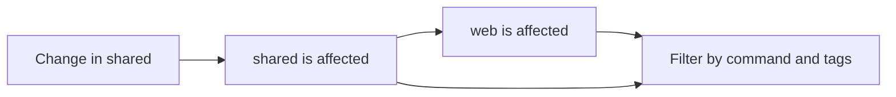

## Workspaces and projects

A **workspace** is a directory containing `isox.json`. Isox searches upward from
your current directory and uses the nearest marker. A nested workspace has its
own root.

A **project** is a directory containing `project.json`. Its name is explicit or
defaults to the directory name, and must be unique within the workspace. Its
location determines the project root.

```text
my-workspace/
├── isox.json
├── package.json
├── apps/
│   └── web/
│       ├── project.json
│       └── src/
└── packages/
    └── shared/
        ├── project.json
        └── src/
```

Project discovery uses `project.json` files. Package-manager workspace settings
continue to control dependency installation and package linking.

## Commands and executors

A **command** is a named entry under a project's `targets` object, such as
`build`, `lint`, or `test`. An **executor** is the implementation that runs it.
Commands can have any name; `build` has no special scheduling behavior.

```json
{
  "name": "shared",
  "targets": {
    "build": {
      "executor": "js:tsc",
      "options": { "tsConfig": "packages/shared/tsconfig.json" }
    }
  }
}
```

Run that command with `isox build shared` or `isox run shared:build`.
The `js:tsc` reference resolves to the `tsc` executor in `@isox-sh/js`, which must
be installed in the workspace. First-party references can omit `@isox-sh/`.

The built-in `core:run-command` executor ships with the CLI and runs shell
commands. Each plugin defines how it interprets options and chooses a working
directory. [Shell commands](/docs/shell-commands) default to the workspace root;
[Vitest](/docs/vitest) runs from the project root.

## Configurations

A **configuration** is a named set of option overrides on one command. Select it
with `--config=production` or use `--prod` for `production`. A command can set
`defaultConfiguration` for invocations that do not choose a configuration.

Overrides merge at the top level. Nested objects and arrays replace their base
values. Put tool flags in executor options or tool configuration files; the CLI
does not forward arbitrary flags to executors.

See the [CLI reference](/docs/cli#named-configurations) for complete examples.

## Project dependencies

Discovery builds a graph from TypeScript and JavaScript imports, local package
dependencies, TypeScript path aliases, and explicit `dependencies` in
`project.json`. Type-only imports and test files also contribute to this graph.

For example, if `web` imports `shared`, a change to `shared` affects both projects:



Use explicit dependencies for relationships that cannot be inferred, such as
dynamically selected plugins. Dependencies contain Isox project names.

<Note>
  The graph propagates affected changes. It does not schedule prerequisite tasks.
  Build libraries before their consumers, and prepare required outputs in every
  CI worker. Parallel commands do not imply a dependency execution order.
</Note>

## Discovery caching

Isox stores discovered project configuration in `.isox/workspace.json` and reuses
it for single-project commands. After changing project definitions, dependencies,
or import relationships, run `isox reset` to refresh the next discovery.

`affected`, `plan`, and `run-many` always scan current project files and refresh
the cache. Creating a project with `isox init <package> <path>` also refreshes it.

This cache stores workspace metadata. Tasks still execute on each invocation.
The TypeScript executor separately tracks output ownership under `.isox/tsc/`.

## Selecting and distributing work

| Command | Use it to |
| --- | --- |
| `isox build web` | Run one project's command |
| `isox affected --target=test` | Run changed projects and their dependents |
| `isox run-many --target=test --projects=web,shared` | Run a selected set of projects |
| `isox plan --target=test --max-jobs=3` | Print a weighted matrix for CI workers |

Selection filters projects by the command they expose and optional tags.
`plan.weight` estimates relative work for distributing projects across CI jobs.
See [affected projects and CI](/docs/affected-and-ci) for Git comparisons, tag filters,
stage ordering, and the exact worker contract.
